# SundaySort

[](https://github.com/alokgadhwalx/sunday-sort/actions/workflows/tests.yml)


[](LICENSE)

**Your Downloads folder, tidied automatically once a week, plus a report of what's safe to delete.**

SundaySort is a small PowerShell tool for Windows. Every week it takes the loose files in your Downloads folder and sorts them into folders by type: PDFs, images, installers, archives and so on. Then it tells you how much space you could free: **installers for apps you already have, zip files you've already unzipped, and duplicates**. It **never deletes anything on its own**, and every sort can be undone.

<p align="center">
  
</p>

## Features

- **Sorts by file type** into 16 folders (Documents, Images, Videos, Audio, Archives, Installers, Code, Design, Fonts and more)
- **Or by where a file came from.** Windows records the website each download came from. SundaySort can use that to put files into `From WhatsApp`, `From Gmail`, `From Google Drive` and so on, or into your own folders, such as anything from your bank's site going to `Finance`. This works even when the file name is useless, like `1000221658.pdf`.
- **Rules based on file names.** For example, `*invoice*` goes to `Finance` and `Screenshot*` goes to `Images\Screenshots`.
- **Right-click any folder → "Tidy with SundaySort"**, not just Downloads. On Windows 11 it's under *Show more options*.
- **Runs on its own every week, or live.** The weekly run catches up the next time you turn your PC on if it was off. In **live mode** (`-Live`), new downloads are sorted about 2 minutes after they finish, so you have time to open them first.
- **Never deletes.** Exact duplicates (same contents, checked with SHA-256) go into a `_Duplicates` folder for you to review.
- **Undo with one command.** Every run is logged.
- **Finds space you can free.** Each week it checks for installers of apps that are already installed (same or older version), zip files whose contents are already unzipped, and duplicates anywhere in Downloads. You get a report to review, and nothing is deleted until you say so.
- **Tells you what it did.** After each weekly run, a Windows notification says something like *"SundaySort tidied 23 files (1.2 GB) · You could free 6.1 GB"*, with **Review**, **Open folder** and **Undo** buttons and a running total (*"1,240 files sorted since 19 Nov 2026"*).
- **Leaves downloads in progress alone.** `.crdownload` and `.part` files, and anything changed in the last 10 minutes, are skipped.
- **Never overwrites files.** If a name is taken, the new file gets ` (2)` added to its name.
- **Custom rules.** Use a small JSON file to add or rename folders.
- No dependencies. It uses Windows PowerShell 5.1, which comes with Windows 10 and 11, and also works with PowerShell 7.

## Install

1. Download this repo: **Code → Download ZIP**, then unzip it. Or use `git clone`.
2. Open PowerShell in that folder and run:

```powershell
powershell -ExecutionPolicy Bypass -File .\Install.ps1
```

The installer first shows a **preview** of what it would do. Then it schedules a weekly run for **Sunday at 9 PM**. No admin rights are needed.

To use a different day or time:

```powershell
powershell -ExecutionPolicy Bypass -File .\Install.ps1 -Day Friday -Time "6:30 PM"
```

You can add any of these options:

| Option | What it does |
|---|---|
| `-Live` | Also sort new downloads as they arrive (see [Live mode](#live-mode)) |
| `-BySource` | Also sort by website: `From WhatsApp`, `From Gmail`, `From Google Drive`, `From Discord`… |
| `-RulesFile .\my-rules.json` | Use your own rules (see [Custom rules](#custom-rules)) |
| `-NoNotify` | No notification after the weekly run |
| `-NoCleanupReport` | Don't look for space you could free |
| `-NoContextMenu` | Don't add "Tidy with SundaySort" to the right-click menu |

## Live mode

```powershell
powershell -ExecutionPolicy Bypass -File .\Install.ps1 -Live
```

A small watcher starts when you log in and sorts each new download shortly after it finishes:

- **Files that are still downloading are never touched**: `.crdownload`, `.part` and the like.
- **A file is moved only after it has stopped changing for 2 minutes**, so you can open it from your browser first. Change this with `-SettleSeconds 60`.
- **Files that are open in another app are skipped** and tried again later.
- **It uses almost no resources.** Windows tells it when the folder changes, so it isn't constantly scanning.
- **Every live sort is logged and can be undone**, just like the weekly run. Notifications replace each other instead of piling up.

The weekly run still happens, and it's what sends the cleanup report. Uninstalling stops and removes live mode.

## Sort by where a file came from

When you download a file, your browser tags it with the page and server it came from, a Windows feature called the *Mark of the Web*. SundaySort reads that tag locally. Nothing is sent anywhere.

With `-BySource`, files from these sites get their own folders: **WhatsApp, Gmail, Google Drive, Outlook, Teams, OneDrive, Discord, Telegram, Slack, GitHub, LinkedIn, Canva, Office Online, ChatGPT, Claude**. Files from any other site, and files with no tag, are sorted by type as usual.

For your own sites, add a `sources` section to your rules. A rule matches the site and its subdomains, so `mybank.com` also matches `netbanking.mybank.com`, but not look-alikes such as `mybank.com.evil.net`:

```json
{ "sources": { "Finance": ["mybank.com", "*.paypal.com"], "College": ["*.university.edu"] } }
```

*Good to know:* the tag is added by browsers like Edge, Chrome, Brave and Firefox, and by most apps that save downloads. Files you copied from a USB drive or made yourself don't have one.

## Find space you can free

```powershell
.\Find-Reclaimable.ps1                 # look only: prints a summary and writes an HTML report
.\Remove-Reclaimable.ps1 -ListOnly     # preview what would be moved
.\Remove-Reclaimable.ps1               # asks once, then moves them to the Recycle Bin
```

| It flags | How it decides |
|---|---|
| **Installers for apps you have** | Matches the installer's name and product info against the apps installed on your PC. Skips it if the installer is a **newer** version than what's installed, since that might be an update you still want. |
| **Archives you've already unzipped** | A `.zip` is only flagged when a folder with the same name holds **every file** in the zip. `.rar`/`.7z` files are flagged when a matching folder exists, and the report says their contents weren't checked. |
| **Duplicates** | Same size and same SHA-256 hash. It keeps the copy that's already sorted. |

It only looks at loose files and the folders SundaySort creates, **never inside your own folders**. Two unzipped apps can legitimately contain identical files, and removing one could break an app. To scan everything anyway, use `-IncludeAllFolders`.

The report says *why* each file was flagged, and clicking a file opens its folder. `Remove-Reclaimable.ps1` checks everything again first: it skips files that have changed since the report, and duplicates whose kept copy has gone missing. It only ever uses the **Recycle Bin**.

## Use it without installing

```powershell
.\Sort-Downloads.ps1 -DryRun      # preview only
.\Sort-Downloads.ps1              # sort now
.\Undo-LastSort.ps1               # put everything back
```

| Option | What it does |
|---|---|
| `-DryRun` | Shows what would move. Moves nothing. |
| `-Path <folder>` | Sorts a different folder (default: your Downloads folder, even if you moved it) |
| `-MinAgeMinutes 10` | Skips files changed more recently than this |
| `-RulesFile <file>` | Uses custom rules (see below) |
| `-BySource` | Sorts files from well-known sites into `From <site>` folders |
| `-NoDuplicateCheck` | Doesn't look for duplicate files |
| `-Notify` | Shows a notification with a summary when done |

## Custom rules

Copy `examples/rules.example.json` and edit it. It has three sections, and you can use any of them:

```json
{
  "names":   { "Finance": ["*invoice*", "*receipt*"], "Images\\Screenshots": ["Screenshot*"] },
  "sources": { "Finance": ["mybank.com"], "College": ["*.university.edu"] },
  "folders": { "Books": [".epub", ".mobi"], "3D Models": [".stl", ".obj"] }
}
```

| Section | Matches on | Example |
|---|---|---|
| `names` | The file name, with `*` wildcards, ignoring capitals | `"*invoice*"` matches `Invoice-2026-11.pdf` |
| `sources` | The website it was downloaded from | `"mybank.com"` |
| `folders` | The file extension, overriding the built-in folders | `".epub"` |

Files are checked in this order: **duplicates → `names` → `sources` → built-in sites (with `-BySource`) → file type**. Every move is logged with its reason, such as `name matches *invoice*` or `downloaded from mail.google.com`, so you can always see why a file went where it did.

```powershell
powershell -ExecutionPolicy Bypass -File .\Install.ps1 -RulesFile .\my-rules.json
```

## Uninstall

```powershell
& "$env:LOCALAPPDATA\SundaySort\Uninstall.ps1"
```

This removes the weekly task, the installed scripts, the right-click menu entry and the `sundaysort:` link used by the notification's Undo button. Your sorted files stay where they are.

## Where things live

| What | Where |
|---|---|
| Installed scripts | `%LOCALAPPDATA%\SundaySort\` |
| Undo logs | `%LOCALAPPDATA%\SundaySort\logs\` |
| Cleanup reports | `%LOCALAPPDATA%\SundaySort\reports\` |
| Weekly task | Task Scheduler → `SundaySort - weekly Downloads cleanup` |
| Live mode | Task Scheduler → `SundaySort - live Downloads sorting` (starts when you log in) |
| Undo button link | `HKEY_CURRENT_USER\Software\Classes\sundaysort` (your user only, no admin) |
| Right-click menu | `HKEY_CURRENT_USER\Software\Classes\Directory\shell\SundaySort` and `…\Directory\Background\shell\SundaySort` |
| Running total | `%LOCALAPPDATA%\SundaySort\logs\stats.json` |

## Tests

```powershell
.\tests\Run-Tests.ps1
```

The tests run in throwaway temporary folders and cover sorting, dry runs, duplicates, skipped files, name clashes, undo, custom rules, file-name and download-source rules (including look-alike domains), the running total and the cleanup report. GitHub runs them on every push, on both Windows PowerShell 5.1 and PowerShell 7.

## FAQ

**Will it touch folders that are already in Downloads?**
No. It only moves loose files at the top level of the folder.

**Does it send anything anywhere?**
No. It has no network access and no telemetry. Everything stays on your PC. Sorting by source reads a tag Windows already stores next to each downloaded file; it doesn't look anything up online.

**Windows says the script "cannot be loaded because running scripts is disabled".**
Use the `powershell -ExecutionPolicy Bypass -File ...` form shown above. It only affects that one command.

## License

[MIT](LICENSE)
